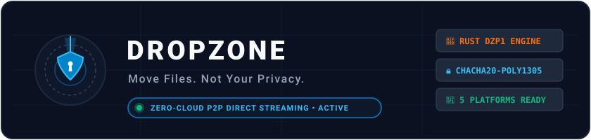

<p align="center">
  
</p>

<p align="center">
  <a href="https://github.com/Rohanjm911/DROPZONE"></a>
  <a href="#-testing--quality-assurance"></a>
  <a href="#-pre-built-applications--distribution"></a>
  <a href="#-license--privacy-commitment"></a>
</p>

DROPZONE is a high-performance, privacy-first, cross-platform file-sharing application supporting Windows, Linux, macOS, Android, and iOS. Its primary mission is to enable secure, direct device-to-device file transfers over local networks and the internet without relying on traditional cloud file storage.

---

## ⚡ Quick Start (No Build Required)

Pre-built binaries and application distribution packages are available directly in the root directory:

* **Windows Standalone**: Double-click [`DropZone.exe`](DropZone.exe) or run [`Run-DropZone.bat`](Run-DropZone.bat) in the root folder. No .NET runtime installation required.
* **Windows x64 Package**: [`DropZone-Desktop-Windows-x64/`](DropZone-Desktop-Windows-x64/) contains the standalone desktop package with embedded runtime and native Rust engine.
* **Portable Desktop**: [`DropZone-Desktop-Portable/`](DropZone-Desktop-Portable/) contains the framework-dependent cross-platform desktop build (`dotnet DropZone.UI.dll`).
* **Android**: [`DropZone-Android/`](DropZone-Android/) contains the mobile platform library, `AndroidManifest.xml` (foreground service & wake locks), and deployment guide.
* **iOS**: [`DropZone-iOS/`](DropZone-iOS/) contains the iOS platform library, `Info.plist` (Bonjour and background processing), and Xcode distribution guide.
* **Native Engine**: [`DropZone-Native-Engine/`](DropZone-Native-Engine/) contains `dropzone_engine.dll` and the C-ABI header `dropzone_engine.h`.

---

## 📡 Live P2P Streaming Architecture

<p align="center">
  
</p>

* **Zero-Cloud Intermediaries**: Chunks stream directly peer-to-peer over LAN or reflexive P2P NAT bindings.
* **Authenticated Encryption**: ChaCha20-Poly1305 AEAD with sequence nonces renders TURN blind relays unable to decrypt file payloads.
* **Multi-Gigabit Throughput**: Dynamic adaptive chunk sizing ($64\text{ KB} \leftrightarrow 4\text{ MB}$) guarantees optimal TCP window scaling and wire saturation.

---

## 🚀 Key Highlights

* **True Zero-Cloud Architecture**: Transfers stream directly peer-to-peer (P2P). No intermediary server ever stores, decrypts, or buffers your data.
* **Modern Hybrid Tech Stack**:
  * **Frontend**: C# / .NET 11 / Avalonia UI 11.2 (XAML, MVVM via `CommunityToolkit.Mvvm`) — responsive desktop and mobile UX with solid color palettes (zero gradients), crisp typography, and dark/light themes.
  * **Core Engine**: Rust + Tokio async networking (`DZP1` protocol) — memory-safe, ultra-low latency, multi-gigabit throughput.
  * **Storage**: Embedded SQLite (WAL mode) with thread-safe connection pooling for atomic transfer history, paired devices, and permission audits.
* **Military-Grade Security**:
  * Authenticated End-to-End Encryption (AEAD: ChaCha20-Poly1305 with sequence nonces / AES-256-GCM).
  * Ephemeral Curve25519 (`X25519`) Diffie-Hellman key agreement + RFC 5869 HKDF-SHA256 session derivation (Perfect Forward Secrecy).
  * Cryptographic pairing via 6-digit Short Authentication String (SAS) numeric PIN matching and QR code pairing.
  * SHA-256 streaming verification per chunk and full-file verification.
  * Isolated Quarantine Vault (`%LOCALAPPDATA%/DropZone/Quarantine/`) with heuristic threat analyzer (RTLO spoofing, hidden extensions).
  * Never automatically executes received files.

---

## 💻 Live Session Simulation

<p align="center">
  
</p>

---

## 🏛 System Architecture Overview

DROPZONE follows a clean, decoupled 8-layer architecture:

```
┌─────────────────────────────────────────────────────────────┐
│                    Presentation Layer                       │
│     (Avalonia UI, XAML, MVVM, MainView Desktop & Mobile)    │
└─────────────────────────────┬───────────────────────────────┘
                              │
┌─────────────────────────────▼───────────────────────────────┐
│                     Application Layer                       │
│ (Transfer Orchestrator, Queue, Speed/ETA Calc, Pairing Coor)│
└──────────────┬───────────────────────────────┬──────────────┘
               │                               │
┌──────────────▼──────────────┐ ┌──────────────▼──────────────┐
│        Domain Layer         │ │       Security Engine       │
│(TransferJob, Device, Chunks)│ │ (AEAD, SHA-256, Quarantine) │
└──────────────┬──────────────┘ └──────────────┬──────────────┘
               │                               │
┌──────────────▼───────────────────────────────▼──────────────┐
│                   Infrastructure Layer                      │
│ (Sqlite Repositories, File I/O Streams, Logging, Platform)  │
└──────────────┬───────────────────────────────┬──────────────┘
               │                               │
┌──────────────▼──────────────┐ ┌──────────────▼──────────────┐
│  Platform Integration Layer │ │  Native Networking Engine   │
│(Android/iOS/Desktop Services│ │ (Rust + Tokio, Framed DZP1, │
│ WakeLocks, Notifications)   │ │  STUN/TURN, Adaptive Chunks)│
└─────────────────────────────┘ └─────────────────────────────┘
```

For in-depth architectural details, see [docs/ARCHITECTURE.md](docs/ARCHITECTURE.md).

---

## 📦 Pre-Built Applications & Distribution

All release artifacts are compiled and organized in the root directory:

| Package | Path | Target OS | Description |
| :--- | :--- | :--- | :--- |
| **Standalone Executable** | [`DropZone.exe`](DropZone.exe) | Windows x64 | Direct launcher (89.6 MB, embedded .NET 11 runtime & native Rust engine) |
| **Desktop Standalone** | [`DropZone-Desktop-Windows-x64/`](DropZone-Desktop-Windows-x64/) | Windows 10/11 x64 | Complete standalone distribution folder with batch launcher |
| **Desktop Portable** | [`DropZone-Desktop-Portable/`](DropZone-Desktop-Portable/) | Windows / Linux / macOS | Framework-dependent cross-platform deployment |
| **Android Mobile** | [`DropZone-Android/`](DropZone-Android/) | Android 14+ (API 34+) | Platform library, `AndroidManifest.xml` (foreground service & wake locks) |
| **iOS Mobile** | [`DropZone-iOS/`](DropZone-iOS/) | iOS 17+ | Platform library, `Info.plist` (Bonjour & background tasks) |
| **Native Systems Core** | [`DropZone-Native-Engine/`](DropZone-Native-Engine/) | Any (C-ABI) | `dropzone_engine.dll` and complete C-ABI header `dropzone_engine.h` |

---

## 🗺 Phased Development Roadmap & Feature Matrix

### Phase 1: Core File Transfer (Completed ✅)
* Rust Tokio streaming engine (binary framing `DZP1`, 64-byte chunk descriptor, backpressure control).
* C# FFI Interop bridge ([`DropZone.Engine.Interop`](src/DropZone.Engine.Interop/)).
* Domain models, concurrent transfer queue, pause/resume/cancel mechanics, and dynamic speed/ETA calculation.
* SQLite persistence in WAL mode for transfer history and active state tracking.
* Avalonia MVVM desktop UI with drag-and-drop file target card, dark theme, and solid palette.

### Phase 2: Security & Advanced Networking (Completed ✅)
* Authenticated end-to-end encryption with ChaCha20-Poly1305.
* Perfect Forward Secrecy: Ephemeral Curve25519 (`X25519`) DH key agreement and RFC 5869 HKDF-SHA256 session key derivation.
* Out-of-band Short Authentication String (SAS) numeric PIN verification and QR code pairing.
* RFC 5389 STUN client for reflexive NAT discovery and direct P2P hole punching.
* RFC 5766 TURN blind relay client (encrypted chunk forwarding; relay server has zero plaintext visibility).
* Heuristic threat analyzer: Right-to-Left Override (RTLO) Unicode spoofing detection and disguised double extension detection.
* Isolated Quarantine Vault with metadata tracking, safe inspection, and permanent purge.

### Phase 3: Analytics & Device Management (Completed ✅)
* Real-time network telemetry, diagnostic RTT ping probes, and link latency tracking.
* Adaptive chunk sizing engine dynamically scaling between 64 KB and 4 MB based on measured throughput and packet loss.
* Granular device permissions (`DevicePermissions`: auto-accept thresholds, custom folder scoping, forced PIN verification, instant revocation).
* Encrypted local backup vault (`.dzbackup` envelope with PBKDF2 600,000 iterations + AES-256-GCM AEAD).
* Dedicated Avalonia UI Diagnostics & Telemetry view with live connection metrics and encrypted export/import.

### Phase 4: Android & iOS Mobile Applications (Completed ✅)
* Cross-platform platform abstraction layer (`IPlatformService`, `IPlatformWakeLockService`, `IPlatformNotificationService`, `IPlatformStoragePicker`, `IPlatformLifecycleService`).
* **Android Subsystem**:
  * `DropZoneTransferForegroundService` (`FOREGROUND_SERVICE_TYPE_DATA_SYNC`) to prevent Doze-mode teardown.
  * CPU `PARTIAL_WAKE_LOCK` and Wi-Fi `MulticastLock` orchestration for uninterrupted mDNS discovery.
  * Scoped Storage and Storage Access Framework (SAF) URI resolution.
* **iOS Subsystem**:
  * `BGProcessingTask` background execution lifecycle.
  * `UIApplication.SharedApplication.IdleTimerDisabled` auto-lock and sleep prevention.
  * Sandboxed container integration with `UIDocumentPickerViewController`.
  * `NSLocalNetworkUsageDescription` and Bonjour services registration (`_dropzone._tcp`).
* **Responsive UI Adaptation**:
  * Unified `MainView.axaml` supporting both Desktop (`IClassicDesktopStyleApplicationLifetime`) and Mobile (`ISingleViewApplicationLifetime`).
  * Responsive navigation: 200px Left Rail for wide/desktop screens and thumb-friendly Bottom Navigation Bar for mobile viewports (< 768px).

### Phase 5: Pro & Enterprise Functionality (Completed ✅)
* **Bidirectional Folder Synchronization**: Directory tree delta scanner, atomic `.syncpart` write staging, and configurable conflict resolution policies (`SourceWins`, `TargetWins`, `NewerTimestampWins`, `LargerFileWins`).
* **Tamper-Evident Compliance Audit Ledger**: Immutable SQLite append-only log protected by SHA-256 hash chaining:
  $$\text{EntryHash}_n = \text{SHA256}(\text{Seq}_n \parallel \text{Timestamp}_n \parallel \text{EventType}_n \parallel \text{Actor}_n \parallel \text{Target}_n \parallel \text{Details}_n \parallel \text{EntryHash}_{n-1})$$
  Features mathematical integrity verification detecting modified rows or sequence deletions.
* **Enterprise PKI Certificate Validation**: X.509 device identity verification, internal Root CA enrollment, and CRL revocation checks.
* **Bandwidth Throttling & QoS**: Token-bucket rate limiter regulating network utilization across shared uplinks.

### Phase 6: Final QA & Production Release (Completed ✅)
* Full-stack end-to-end integration tests validating all 8 application layers in sequence.
* Complete technical, security, protocol, and installation documentation.

---

## 🧪 Testing & Quality Assurance

DROPZONE maintains an automated test suite across both the Rust networking core and the .NET application stack:

```text
============================================================
TEST SUMMARY: 73 / 73 PASSING (100% Pass Rate)
============================================================
* .NET Unit & Integration Tests (xUnit):  60 Passed, 0 Failed
* Rust Core Engine Tests (Cargo Test):   13 Passed, 0 Failed
============================================================
```

### Running Tests Locally

#### .NET Test Suite
```bash
dotnet test tests/DropZone.UnitTests/DropZone.UnitTests.csproj
```

#### Rust Engine Test Suite
```bash
cargo test --manifest-path engine/Cargo.toml
```

---

## 🛠 Building From Source

### Prerequisites
* **.NET 11.0 SDK** (or .NET 8.0 / 9.0)
* **Rust 1.80+ (Cargo)**
* **C/C++ Build Tools** (MSVC on Windows, GCC/Clang on Linux/macOS)

### 1. Build Native Rust Engine
```bash
cargo build --release --manifest-path engine/Cargo.toml
```
The compiled library will be output to `engine/target/release/dropzone_engine.dll` (or `.so` / `.dylib`).

### 2. Build .NET Solution
```bash
dotnet build src/DropZone.slnx -c Release
```

### 3. Publish Standalone Desktop Application
```bash
dotnet publish src/DropZone.UI/DropZone.UI.csproj -c Release -r win-x64 --self-contained true -p:PublishSingleFile=true -o builds/desktop
```

---

## 📄 Documentation

Comprehensive technical documentation is maintained in the [`docs/`](docs/) directory:

* [Architecture Specification](docs/ARCHITECTURE.md) – Structural breakdown of all 8 layers.
* [Security Specification](docs/SECURITY.md) – Cryptographic protocols, threat model, and defense-in-depth.
* [Networking Protocol](docs/NETWORKING_PROTOCOL.md) – Binary transport framing (`DZP1`), STUN/TURN, and adaptive chunking.
* [Installation & Deployment Guide](docs/INSTALLATION.md) – Setup guides for Windows, Linux, macOS, Android, and iOS.
* [API Reference](docs/API_REFERENCE.md) – Complete C-ABI FFI and C# domain API documentation.
* [Testing Guide](docs/TESTING.md) – Test organization, mocking, and release validation procedures.
* [Contribution Guidelines](docs/CONTRIBUTING.md) – Code style, security policies, and pull request workflow.
* [Release Notes](docs/RELEASE_NOTES.md) – Production v1.0.0 release changelog.

---

## ⚖️ License & Privacy Commitment

DROPZONE is built on an uncompromising commitment to personal privacy:
* Zero remote file storage.
* Zero plaintext telemetry.
* Zero analytics tracking.

**Move Files. Not Your Privacy.**
